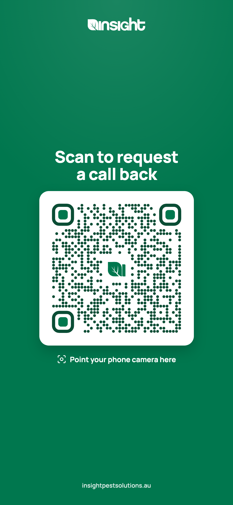
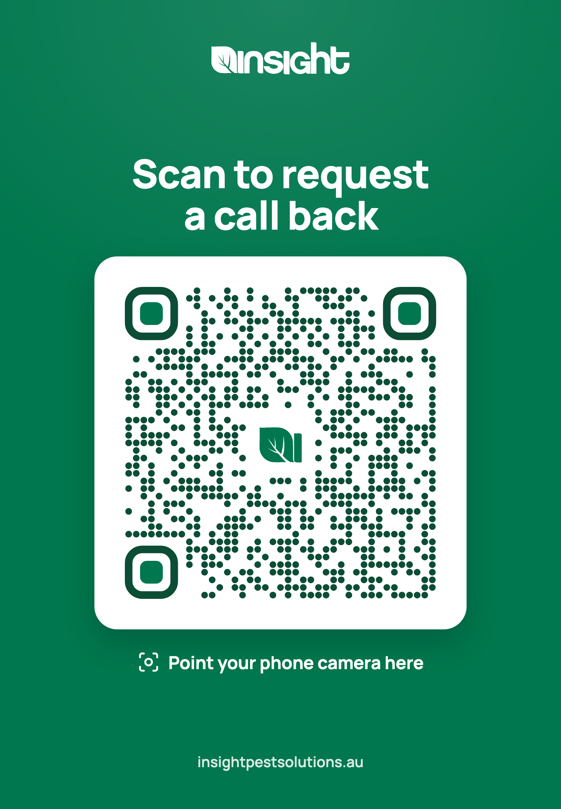
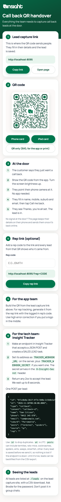
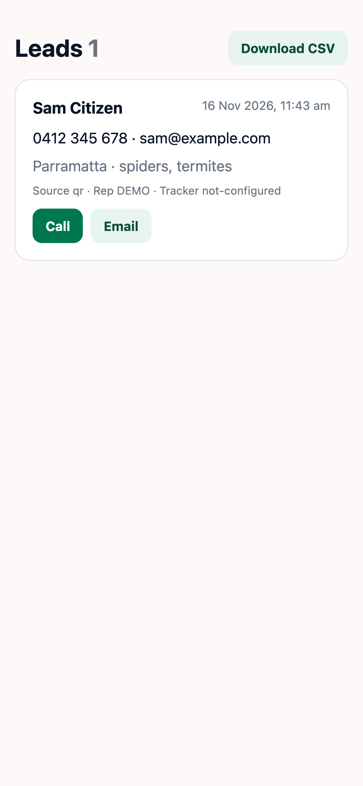

# Insight Lead Capture: QR Code

A one-page call back form for Insight Pest Solutions door teams.

At the door, a customer who only wants a call back scans a QR code shown in the rep's app. The code opens this form on their own phone. They leave their name, mobile, suburb and email, and the lead is saved and sent on to Insight Tracker.

| | |
|---|---|
| Preview form | https://insight-quote-production.up.railway.app |
| Preview handover page | https://insight-quote-production.up.railway.app/handover |
| Host it yourself | [Deploy on your own system](#deploy-on-your-own-system) |
| Tech spec for Insight Tracker | [docs/TECH-HANDOVER.md](docs/TECH-HANDOVER.md) |

The Railway links are a **preview** so you can see it working. Insight hosts the real one on its own system using the steps below.

## QR code downloads

Every file opens the preview form. Rebuild them for your own address before going live (see [Rebuild the QR codes](#rebuild-the-qr-codes)). Every image was decoded by a QR reader to check it opens the right page.

| For | Size | Download |
|---|---|---|
| **Everything in one zip** | All 12 files below | [insight-qr-all.zip](https://github.com/Brodie-Eaze/insight-lead-capture-qr-code/raw/main/public/qr/insight-qr-all.zip) |
| iPhone | 1179 x 2556 full screen card | [insight-qr-iphone.png](https://github.com/Brodie-Eaze/insight-lead-capture-qr-code/raw/main/public/qr/screens/insight-qr-iphone.png) |
| Android phone | 1080 x 2400 full screen card | [insight-qr-android.png](https://github.com/Brodie-Eaze/insight-lead-capture-qr-code/raw/main/public/qr/screens/insight-qr-android.png) |
| Older or smaller phone | 1080 x 1440 card | [insight-qr-phone-short.png](https://github.com/Brodie-Eaze/insight-lead-capture-qr-code/raw/main/public/qr/screens/insight-qr-phone-short.png) |
| iPad and iPad Air | 1640 x 2360 full screen card | [insight-qr-ipad.png](https://github.com/Brodie-Eaze/insight-lead-capture-qr-code/raw/main/public/qr/screens/insight-qr-ipad.png) |
| iPad Pro | 2048 x 2732 full screen card | [insight-qr-ipad-pro.png](https://github.com/Brodie-Eaze/insight-lead-capture-qr-code/raw/main/public/qr/screens/insight-qr-ipad-pro.png) |
| QR for the app | SVG with logo, sharp at any size | [insight-qr.svg](https://github.com/Brodie-Eaze/insight-lead-capture-qr-code/raw/main/public/qr/plain/insight-qr.svg) |
| QR without logo | SVG | [insight-qr-no-logo.svg](https://github.com/Brodie-Eaze/insight-lead-capture-qr-code/raw/main/public/qr/plain/insight-qr-no-logo.svg) |
| QR as PNG | 512, 1024 and 2048 px | [512](https://github.com/Brodie-Eaze/insight-lead-capture-qr-code/raw/main/public/qr/plain/insight-qr-512.png) · [1024](https://github.com/Brodie-Eaze/insight-lead-capture-qr-code/raw/main/public/qr/plain/insight-qr-1024.png) · [2048](https://github.com/Brodie-Eaze/insight-lead-capture-qr-code/raw/main/public/qr/plain/insight-qr-2048.png) |
| Print | A4 poster and A5 flyer PDFs | [A4](https://github.com/Brodie-Eaze/insight-lead-capture-qr-code/raw/main/public/qr/print/insight-qr-a4.pdf) · [A5](https://github.com/Brodie-Eaze/insight-lead-capture-qr-code/raw/main/public/qr/print/insight-qr-a5.pdf) |

 

## Screenshots

All screenshots are taken on a phone sized screen with made up details.

| 1. Form | 2. Filled in | 3. Sent |
|---|---|---|
|  |  |  |

| 4. Team handover page | 5. Leads list (password protected) |
|---|---|
|  |  |

## How it works

```
Rep's app shows QR  →  customer scans  →  form (/)  →  POST /api/lead
                                                         │
                                       saved to leads.jsonl first
                                                         │
                                       sent to Insight Tracker webhook
                                       (when TRACKER_WEBHOOK_URL is set)
```

1. The QR code opens the form. Add `?rep=CODE` to the link and every lead from that code is tagged with the rep.
2. The form checks the details on the phone, then sends them to the server.
3. The server checks them again, saves the lead, tells the phone it worked, then posts it to Insight Tracker.
4. If the phone has no signal, the form keeps the details on the phone and sends them when it is back online.
5. The team can see every lead at `/leads` and download them at `/leads.csv`. Both need the leads password.

## What's in this repo

```
.
├── server.mjs              The whole server: serves the pages, takes leads, sends them to Insight Tracker, leads list
├── test.mjs                Checks the lead validation rules (npm test)
├── package.json            No dependencies. Node 20 or newer
├── Dockerfile              Container image for hosting it yourself
├── .env.example            Every setting, copy to .env and fill in
├── railway.json            Settings for our Railway preview only
│
├── public/                 Everything the browser loads
│   ├── index.html          The call back form (what the QR opens)
│   ├── form.css            Styles for the form
│   ├── form.js             Pest dropdown label, sends the form, thank you screen, offline queue
│   ├── handover.html       Team handover page: link, QR downloads, door steps, rep links, tech spec
│   ├── leads.css           Styles for the password protected leads list
│   ├── qr.html             Old QR page. Forwards to /handover
│   ├── brand/              Insight logo and leaf mark
│   └── qr/                 Ready to use QR codes (built by tools/make_qr.py)
│       ├── screens/        Full screen cards: iPhone, Android, older phone, iPad, iPad Pro
│       ├── plain/          QR on its own: SVG with and without logo, PNG 512 / 1024 / 2048
│       ├── print/          A4 and A5 PDFs
│       └── insight-qr-all.zip  Everything above in one file
│
├── tools/
│   ├── make_qr.py          Rebuilds the QR codes in public/qr for your address
│   └── requirements.txt    Python package the QR tool needs
│
└── docs/
    ├── TECH-HANDOVER.md    How Insight Tracker receives leads (fields, headers, retries)
    └── screenshots/        The images in this README
```

## Pages and endpoints

| Path | What it is | Who uses it |
|---|---|---|
| `/` | Call back form | Customers, from the QR |
| `/handover` | Team handover page | Reps, app team, tech team |
| `POST /api/lead` | Takes one lead as JSON | The form |
| `/leads` | Leads list | Insight team, password needed |
| `/leads.csv` | All leads as a spreadsheet | Insight team, password needed |
| `/qr/...` | QR code images | App team, print |
| `/health` | Returns `ok` | Health checks and uptime monitors |

## Run it on your computer

You need Node 20.6 or newer. There is nothing to install.

```bash
npm test
```

```bash
cp .env.example .env
```

Put a password in `LEADS_PASSWORD` in `.env`, then start it:

```bash
node --env-file=.env server.mjs
```

Open http://localhost:8093. Leads are saved to `data/leads.jsonl`, which git ignores.

## Settings

Set these as environment variables. None are stored in the code.

| Variable | Needed | What it does |
|---|---|---|
| `LEADS_PASSWORD` | Yes | Password for `/leads` and `/leads.csv` |
| `DATA_DIR` | Yes, in production | Folder for `leads.jsonl`. Must be storage that survives restarts and redeploys. Defaults to `data/` in the repo |
| `TRACKER_WEBHOOK_URL` | To connect Insight Tracker | Where each lead is posted |
| `TRACKER_WEBHOOK_SECRET` | Optional | Sent in the `X-Insight-Secret` header so Insight Tracker can check the post is from us |
| `PORT` | Optional | Defaults to 8093. Most hosts set it for you |

## Deploy on your own system

It is one Node file with no dependencies, so it runs anywhere Node 20 or Docker runs.

**What you need**
- A server or container host that runs Node 20+ or Docker
- A web address with HTTPS, for example `callback.insightpestsolutions.au`. HTTPS is required because the leads login cookie only works over HTTPS
- Storage that survives restarts, for `leads.jsonl`

**Option A: Docker**

```bash
docker build -t insight-lead-capture .
```

```bash
docker run -d --name insight-lead-capture -p 8093:8093 -v insight-leads:/data -e LEADS_PASSWORD=change-me insight-lead-capture
```

Add `-e TRACKER_WEBHOOK_URL=...` and `-e TRACKER_WEBHOOK_SECRET=...` once Insight Tracker is ready. The image saves leads in `/data`, so keep that volume.

**Option B: Node**

```bash
cp .env.example .env
```

Fill in `.env`, with `DATA_DIR` pointing at storage that survives restarts. Then run it under your process manager (systemd, pm2 or similar):

```bash
node --env-file=.env server.mjs
```

**Then, for either option**

1. Put it behind your HTTPS proxy or load balancer, pointing at port 8093. Use one proxy hop: the rate limit reads the last address in `X-Forwarded-For`.
2. Open `https://your-address/health`. It should say `ok`.
3. Rebuild the QR codes for your address (next section). The ones in `public/qr` point at our preview.
4. Submit a test lead, then check it at `https://your-address/leads`.
5. Point the QR in the rep app at your address, with `?rep=CODE` if you track reps.
6. Share `https://your-address/handover` with the team. Its links follow whatever address it is hosted on.

When you change `form.css` or `form.js`, bump the `?v=` number on them in `public/index.html` so phones don't keep the old copy.

Our preview runs on Railway (`railway.json`). You don't need Railway to host it.

## Rebuild the QR codes

Do this once with your own address, and again if it changes. You need Python 3 and Google Chrome.

```bash
pip install -r tools/requirements.txt
```

```bash
python3 tools/make_qr.py https://your-address
```

It rebuilds all of `public/qr`: the five device cards, the plain QR files, the A4 and A5 PDFs and the zip. On a Mac it finds Chrome on its own. Anywhere else, set `CHROME` to the Chrome program first. Then redeploy so the handover page offers the new codes.

## Connect Insight Tracker

Read [docs/TECH-HANDOVER.md](docs/TECH-HANDOVER.md). In short: build an endpoint that accepts a JSON POST and creates a sales lead, then set `TRACKER_WEBHOOK_URL`. Until then, every lead is still saved and shows `Tracker not-configured` on the leads list.

## Privacy and safety

- Leads are personal information. They live only in `leads.jsonl` on the server and in Insight Tracker. Neither is in this repo.
- The leads password and webhook secret are environment variables only.
- The server checks every field, limits how many leads one network can send, ignores bots that fill a hidden field, and blocks spreadsheet formula tricks in the CSV.
- Our Railway preview sits offshore because Railway has no Sydney region. Hosting it yourself lets you keep leads in Australia. Once Insight Tracker is receiving leads, the local copy can be cleared on a schedule.

## Brand

The Insight name, logo and leaf mark belong to Insight Pest Solutions. The code is public so the team can see and use it. That does not grant use of the brand.
