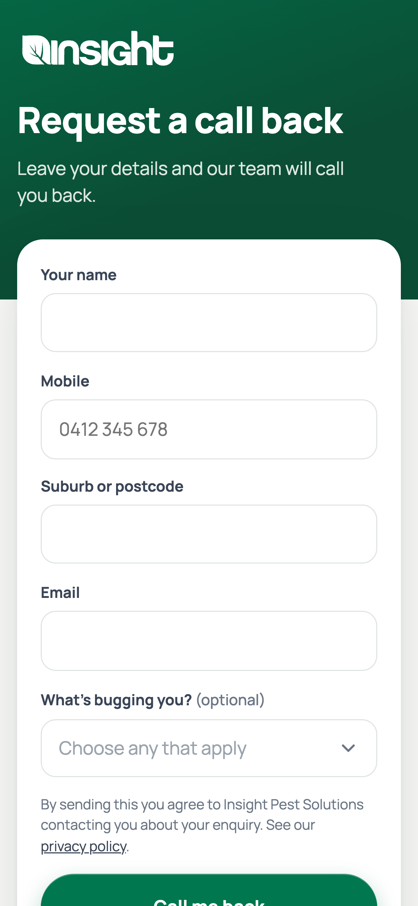
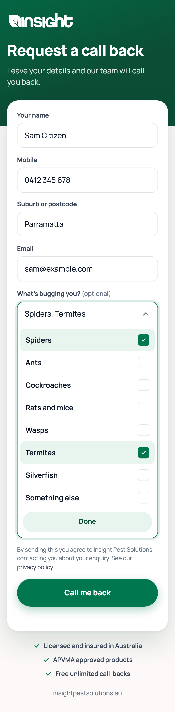
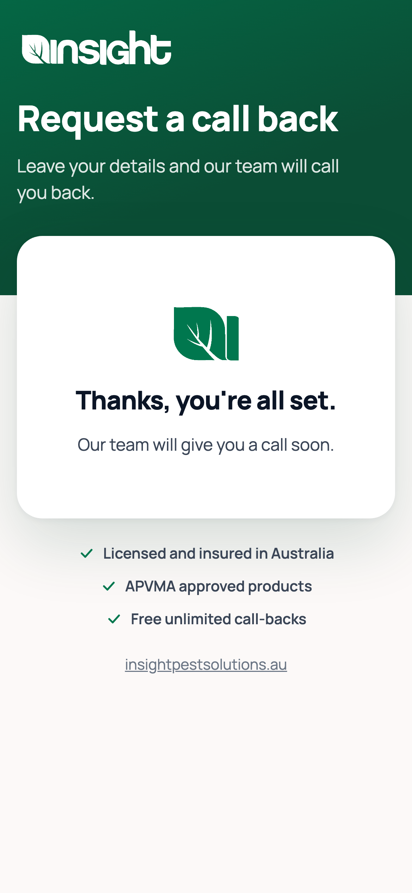

# Insight Lead Capture: QR Code

A one-page call back form for Insight Pest Solutions door teams.

At the door, a customer who only wants a call back scans a QR code shown in the rep's app. The code opens this form on their own phone. They leave their name, mobile, suburb and email, and the lead is saved and sent on to Insight Tracker.

| | |
|---|---|
| Live form (the QR target) | https://insight-quote-production.up.railway.app |
| Team handover page | https://insight-quote-production.up.railway.app/handover |
| Tech spec for Insight Tracker | [docs/TECH-HANDOVER.md](docs/TECH-HANDOVER.md) |

## Screenshots

All screenshots are taken on a phone sized screen with made up details.

| 1. Form | 2. Filled in | 3. Sent |
|---|---|---|
|  |  |  |

| 4. Team handover page | 5. Leads list (password protected) |
|---|---|
|  |  |

## How it works

```
Rep's app shows QR  →  customer scans  →  form (/)  →  POST /api/lead
                                                         │
                                       saved to leads.jsonl first
                                                         │
                                       sent to Insight Tracker webhook
                                       (when TRACKER_WEBHOOK_URL is set)
```

1. The QR code opens the form. Add `?rep=CODE` to the link and every lead from that code is tagged with the rep.
2. The form checks the details on the phone, then sends them to the server.
3. The server checks them again, saves the lead, tells the phone it worked, then posts it to Insight Tracker.
4. If the phone has no signal, the form keeps the details on the phone and sends them when it is back online.
5. The team can see every lead at `/leads` and download them at `/leads.csv`. Both need the leads password.

## What's in this repo

```
.
├── server.mjs              The whole server: serves the pages, takes leads, sends them to Insight Tracker, leads list
├── test.mjs                Checks the lead validation rules (npm test)
├── package.json            No dependencies. Node 20 or newer
├── railway.json            Railway build and health check settings
│
├── public/                 Everything the browser loads
│   ├── index.html          The call back form (what the QR opens)
│   ├── form.css            Styles for the form
│   ├── form.js             Pest dropdown label, sends the form, thank you screen, offline queue
│   ├── handover.html       Team handover page: link, QR downloads, door steps, rep links, tech spec
│   ├── leads.css           Styles for the password protected leads list
│   ├── qr.html             Old QR page. Forwards to /handover
│   ├── brand/              Insight logo and leaf mark
│   └── qr/                 Ready to use QR codes: phone card, iPad card, plain SVG
│
├── tools/
│   └── make_qr.py          Rebuilds the QR codes in public/qr
│
└── docs/
    ├── TECH-HANDOVER.md    How Insight Tracker receives leads (fields, headers, retries)
    └── screenshots/        The images in this README
```

## Pages and endpoints

| Path | What it is | Who uses it |
|---|---|---|
| `/` | Call back form | Customers, from the QR |
| `/handover` | Team handover page | Reps, app team, tech team |
| `POST /api/lead` | Takes one lead as JSON | The form |
| `/leads` | Leads list | Insight team, password needed |
| `/leads.csv` | All leads as a spreadsheet | Insight team, password needed |
| `/qr/...` | QR code images | App team, print |
| `/health` | Returns `ok` | Railway health check |

## Run it on your computer

```bash
npm test
```

```bash
LEADS_PASSWORD=pick-one node server.mjs
```

Then open http://localhost:8093. Leads are saved to `data/leads.jsonl`, which git ignores.

## Settings

Set these as environment variables. None are stored in the code.

| Variable | Needed | What it does |
|---|---|---|
| `LEADS_PASSWORD` | Yes | Password for `/leads` and `/leads.csv` |
| `DATA_DIR` | On Railway | Folder for `leads.jsonl`. On Railway this is the `/data` volume so leads survive deploys |
| `TRACKER_WEBHOOK_URL` | To connect Insight Tracker | Where each lead is posted |
| `TRACKER_WEBHOOK_SECRET` | Optional | Sent in the `X-Insight-Secret` header so Insight Tracker can check the post is from us |
| `PORT` | Set by Railway | Defaults to 8093 |

## Deploy

The live site runs on Railway as the `insight-quote` service. From the repo root:

```bash
railway up --service insight-quote
```

When you change `form.css` or `form.js`, bump the `?v=` number on them in `public/index.html` so phones don't keep the old copy.

## Rebuild the QR codes

Only needed if the form address changes. You need a Mac with Google Chrome in Applications, and Python with `segno` (`pip install segno`).

```bash
python3 tools/make_qr.py
```

It writes `insight-qr-phone.png`, `insight-qr-ipad.png` and `insight-qr.svg` into `public/qr`.

## Connect Insight Tracker

Read [docs/TECH-HANDOVER.md](docs/TECH-HANDOVER.md). In short: build an endpoint that accepts a JSON POST and creates a sales lead, then set `TRACKER_WEBHOOK_URL`. Until then, every lead is still saved and shows `Tracker not-configured` on the leads list.

## Privacy and safety

- Leads are personal information. They live only in `leads.jsonl` on the server and in Insight Tracker. Neither is in this repo.
- The leads password and webhook secret are environment variables only.
- The server checks every field, limits how many leads one network can send, ignores bots that fill a hidden field, and blocks spreadsheet formula tricks in the CSV.
- Railway has no Sydney region, so the server sits offshore. Once Insight Tracker is receiving leads, the local copy can be cleared on a schedule.

## Brand

The Insight name, logo and leaf mark belong to Insight Pest Solutions. The code is public so the team can see and use it. That does not grant use of the brand.
